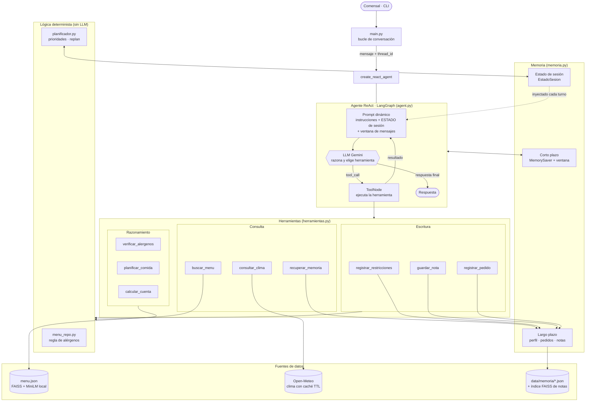
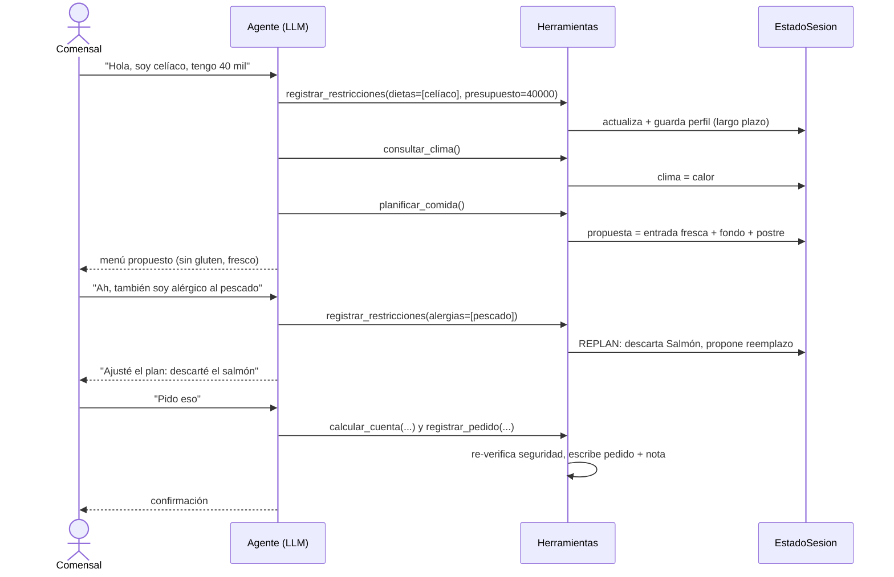
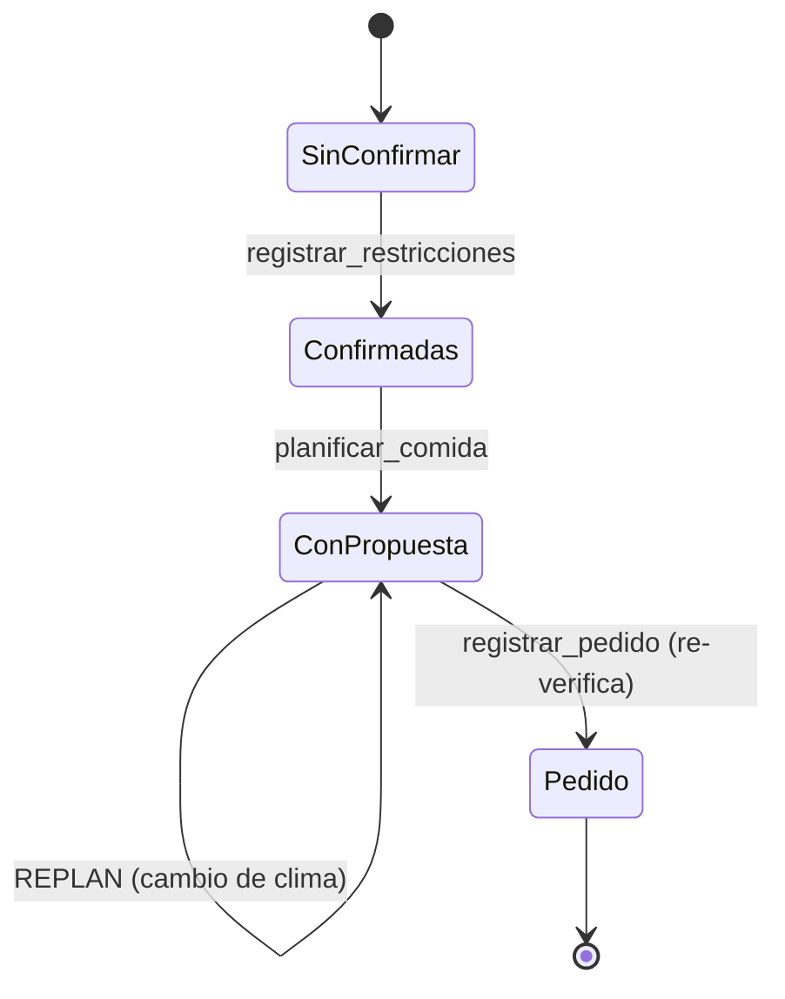

# Orquestación de componentes

## 1. Arquitectura general

## 2. Flujo de trabajo (ejemplo con cambios a mitad de conversación)

## 3. Planificación y replanificación

Prioridad de etapas: **fondo (P1) > entrada (P2) > postre (P3)**. Se recorren en ese orden y cada una
se incluye si su opción segura más barata cabe en el presupuesto restante; el orden de servicio es
entrada → fondo → postre. Ante un cambio, `aplicar_cambio` descarta lo inválido, repropone y deja
una línea `REPLAN` en la bitácora (`/eventos`).

## 4. Capas de memoria

| Capa | Mecanismo | Qué guarda | Duración |
|---|---|---|---|
| Corto plazo | `MemorySaver` (LangGraph) + `trim_messages` | Historial del hilo | Sesión |
| Estado de sesión | `EstadoSesion` inyectado en el system prompt | Restricciones, presupuesto, clima, propuesta, bitácora | Sesión |
| Largo plazo (contenido) | JSON en `data/memoria/` | Perfil, pedidos | Permanente |
| Largo plazo (semántica) | FAISS sobre notas (`recuperar_memoria`) | Gustos, ocasiones, comentarios | Permanente |

El estado de sesión es lo que mantiene la coherencia aunque la ventana de mensajes descarte turnos antiguos.
